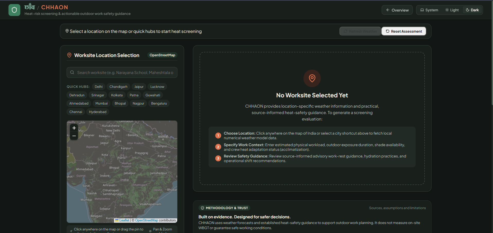
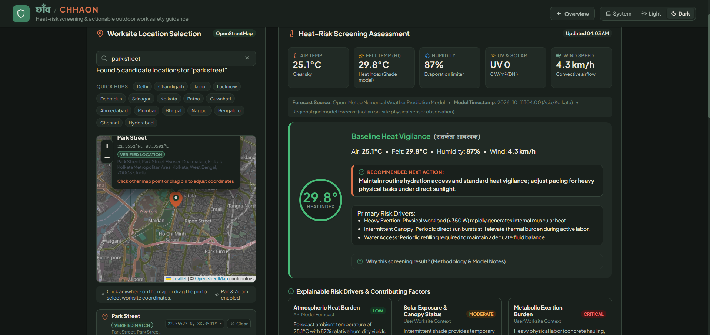
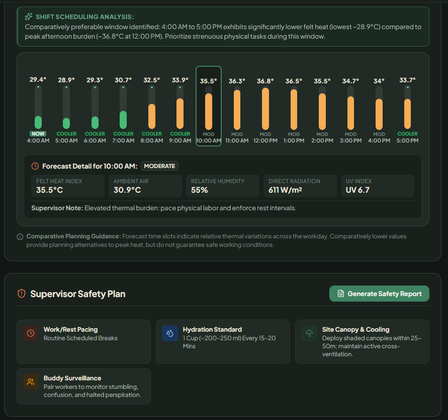

# CHHAON — छाँव

**धूप में सुरक्षा, हर कदम पर छाँव।**  
*A heat-aware planning companion for people who work outdoors.*

<p align="center">
  <a href="https://main.d1z8gzjqk9pupf.amplifyapp.com"><strong>🌐 Open the live app</strong></a>
  &nbsp; · &nbsp;
  <a href="https://github.com/isitamazumder05/CHHAON">View source on GitHub</a>
</p>

CHHAON is a location-based environmental heat-risk screening and work-planning application. It brings weather information, worksite context, forecast-window comparisons, and practical safety actions into one interface to help outdoor workers and supervisors make more informed plans.

> **Important:** CHHAON is a planning aid, not a medical diagnosis or certified occupational heat-stress assessment. Forecasts do not guarantee that any time is safe for work.

## The problem

Outdoor workers can face changing heat and sun exposure throughout the day. Weather alone does not describe the full worksite situation: workload, time spent outdoors, shade, water access, and acclimatization also matter. CHHAON combines available environmental information with user-provided work context to support a more deliberate planning conversation.

## What you can do

- **Explore a location:** Search for a place and inspect the worksite on an interactive map.
- **Review environmental conditions:** View current weather and hourly forecast information, including UV data when available.
- **Add work context:** Record factors such as workload, exposure duration, shade, water access, and heat acclimatization.
- **Review a heat-risk screen:** See a context-aware indication with explanations and practical safety recommendations.
- **Compare forecast windows:** Compare available time slots when considering a work schedule.
- **Prepare a safety action plan:** Review, copy, or print a report for planning and discussion.
- **Understand the results:** Consult the methodology, data sources, and limitations shown in the app.

## Live demo

**[Launch CHHAON on AWS Amplify →](https://main.d1z8gzjqk9pupf.amplifyapp.com)**

The frontend is hosted using **AWS Amplify Hosting** and is connected to this repository's `main` branch. The application retrieves weather information from Open-Meteo and uses OpenStreetMap/Nominatim for map and location-search functionality; those services require network access.

## Technology stack

| Area | Technology |
| --- | --- |
| Frontend | React, TypeScript |
| Development and build | Vite |
| Interactive map | Leaflet with OpenStreetMap data |
| Weather information | Open-Meteo API |
| Location search | OpenStreetMap Nominatim |
| Frontend hosting | AWS Amplify Hosting |
| Backend exploration | AWS SAM starter project in `chhaon-api/` |

## Run locally

### Prerequisites

- Node.js with support for the project's current tooling
- npm

### Setup

```bash
git clone https://github.com/isitamazumder05/CHHAON.git
cd CHHAON
npm install
npm run dev
```

Open the local address printed by Vite in the terminal.

### Checks

The repository defines these scripts:

```bash
npm test
npm run lint
npm run build
```

- `npm test` runs the frontend service tests.
- `npm run lint` runs Oxlint.
- `npm run build` type-checks the project and creates the production frontend bundle in `dist/`.

## How it works

1. The user searches for or selects a location.
2. CHHAON retrieves available weather and forecast data and displays the location on the map.
3. The user enters work-context information relevant to the planned activity.
4. The app combines the available forecast and entered context to present a screening result, compare forecast windows, and suggest practical precautions.
5. The user can review or print the resulting safety action plan.

The output is only as reliable as the available forecast and the information entered. It should be considered alongside on-site observations and applicable workplace procedures.

## AWS implementation status

- **Deployed:** The React frontend is hosted on AWS Amplify Hosting at the live-demo link above.
- **Repository integration:** Amplify builds the frontend from the repository's `main` branch.
- **Backend status:** `chhaon-api/` contains an AWS SAM starter project that has been validated and built locally. It is **not currently integrated with the frontend or deployed as a CHHAON backend**. Do not treat its sample API as an operational part of the live app.

## Data sources and limitations

- **Weather:** [Open-Meteo](https://open-meteo.com/) provides the weather and forecast data used by the app. Forecast values are model-based and can differ from conditions at a specific worksite.
- **Maps and geocoding:** [OpenStreetMap](https://www.openstreetmap.org/) and [Nominatim](https://nominatim.org/) support map display and location search. Search results depend on available map data; a selected map point is not necessarily a verified address.
- **Risk screening:** The result is intended for awareness and planning. It is not a certified WBGT measurement, a medical evaluation, or a substitute for trained occupational-safety judgment or site measurements.
- **Work decisions:** Do not use the app to declare a time or worksite “safe.” Consider actual conditions, workload, worker symptoms, rest breaks, shade, hydration, acclimatization, local guidance, and emergency procedures.

## Responsible use

Use CHHAON as one input to planning—not as the sole basis for assigning outdoor work. Follow applicable occupational safety requirements and seek appropriate assistance if a worker shows signs of heat illness.

## AI tools disclosure

Antigravity and ChatGPT were used as AI-assisted development tools during this project. The author reviewed and tested the implementation.

## Acknowledgements

- [Open-Meteo](https://open-meteo.com/)
- [OpenStreetMap](https://www.openstreetmap.org/)
- [Nominatim usage policy](https://operations.osmfoundation.org/policies/nominatim/)
- [AWS Amplify Hosting documentation](https://docs.aws.amazon.com/amplify/latest/userguide/welcome.html)
- [AWS Serverless Application Model documentation](https://docs.aws.amazon.com/serverless-application-model/latest/developerguide/what-is-sam.html)

- ---

## 📸 Application Screenshots

### Dashboard


### Heat-Risk Assessment


### Safety Action Plan

